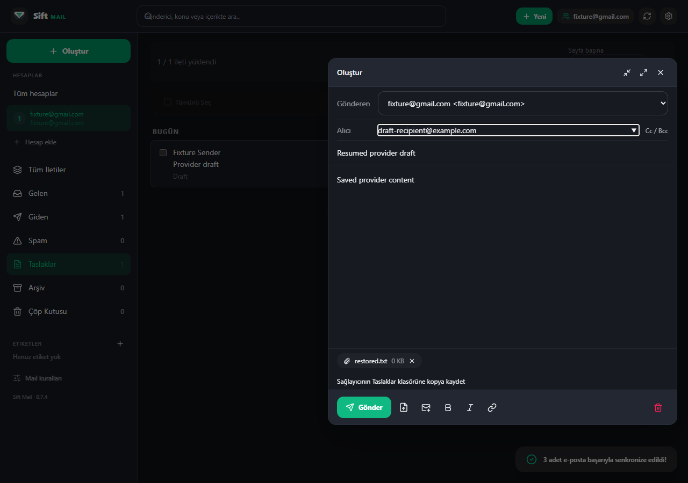
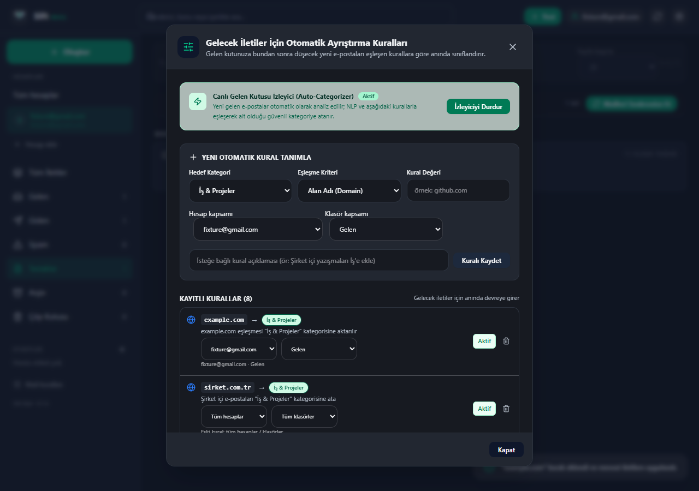

# Sift Mail

### Your inbox, simplified. / Mail kutun, sadeleşsin.

[Download for Windows](https://github.com/canok07/sift-mail/releases/tag/v0.7.4) · [Documentation](docs/development.md) · [MIT License](LICENSE)

## English

**One place for your email.** Sift Mail brings multiple accounts into a customizable desktop inbox, with mail rules and optional AI assistance.

- **Stay organized:** folders, labels, search and background sync.
- **Write with ease:** rich-text messages, attachments, reply-all and conversations.
- **Make it yours:** themes, colors and English/Turkish/German support.
- **Keep control:** encrypted local storage; normal email works without AI.

Windows-first, with Gmail/Outlook OAuth and manual IMAP/SMTP setup. AI and live Gmail/Outlook verification are still in progress.

---

## Türkçe

**Tüm maillerin tek yerde.** Sift Mail, birden fazla hesabı özelleştirilebilir bir masaüstü mail kutusunda buluşturur; mail kuralları ve isteğe bağlı yapay zekâ desteği sunar.

- **Düzenli kal:** klasörler, etiketler, arama ve arka plan eşitlemesi.
- **Kolayca yaz:** biçimlendirilmiş iletiler, ekler, tümünü yanıtlama ve konuşmalar.
- **Kendine göre ayarla:** temalar, renkler ve Türkçe/İngilizce/Almanca desteği.
- **Kontrol sende:** şifreli yerel saklama; normal mail kullanımı AI gerektirmez.

Öncelik Windows; Gmail/Outlook OAuth ve manuel IMAP/SMTP kurulumu bulunur. AI ve gerçek Gmail/Outlook doğrulaması henüz tamamlanmadı.

### Organize your mail / Maillerini düzenle

*Actual application screenshots with sample data. / Gerçek uygulama görüntüleri; örnek veriler kullanılmıştır.*

*The published Windows build is older than the current source and unsigned. / Yayımlanmış Windows paketi güncel kaynaklardan daha eskidir ve imzasızdır.*
